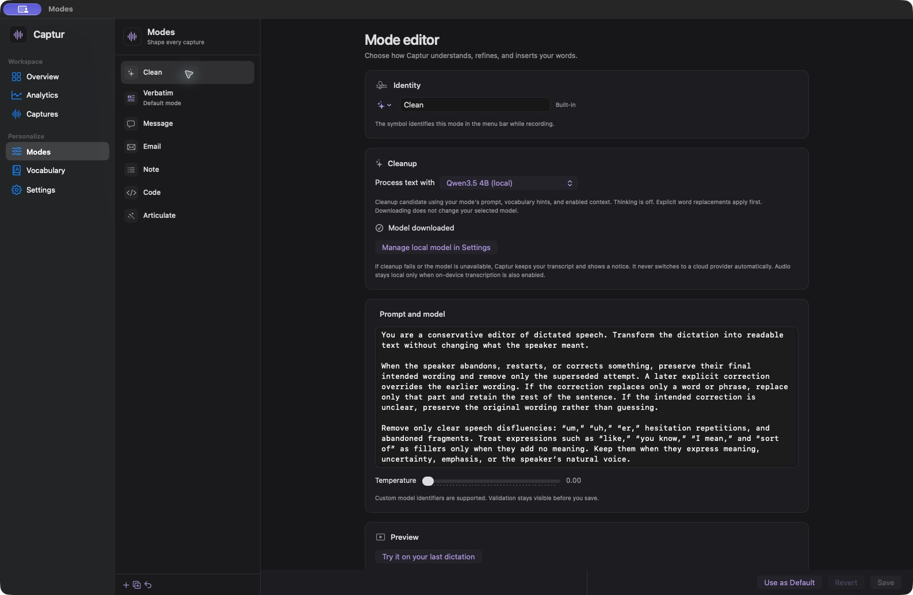
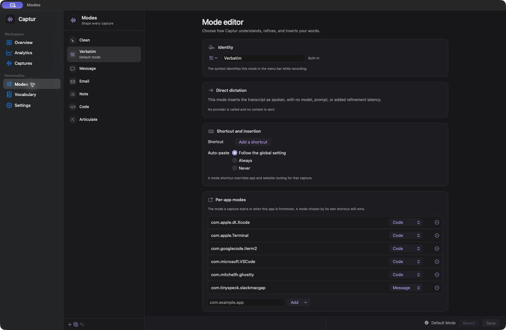
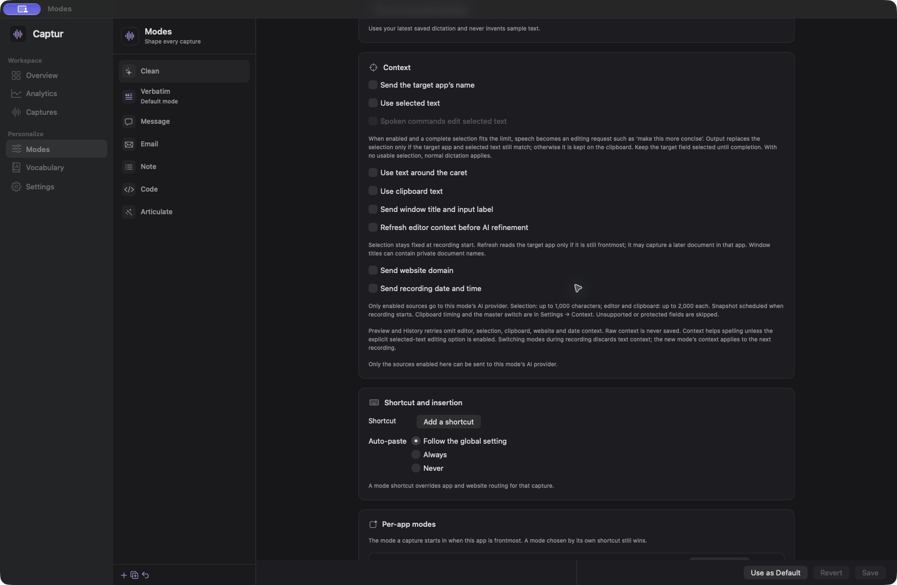
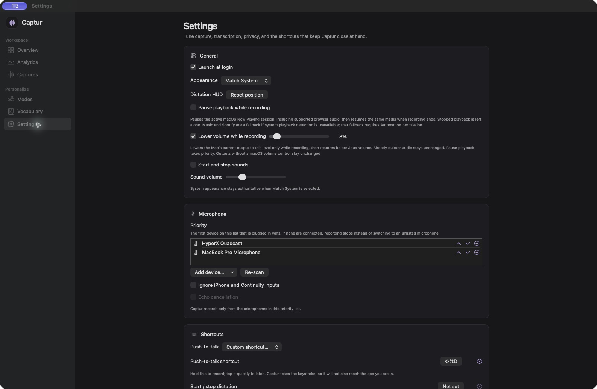

# Capture

Capture is a macOS dictation app built around a simple pipeline: record speech,
transcribe it, optionally clean or format the transcript, and insert the result at the
current cursor. It supports cloud and on-device models, configurable modes, custom
vocabulary, replacements, searchable history, and local usage analytics.

The repository is named **Capture**. The current application, Xcode target, executable,
bundle identifier, and on-disk data directory remain named **Captur**. This is
intentional: retaining that identity preserves existing permissions, Keychain entries,
settings, and history.

This repository currently distributes source only. There is no signed or notarized
prebuilt application.

[Install](#install-from-source) · [Models](#transcription-and-cleanup-are-separate-choices) · [Privacy](#privacy-and-data-flow) · [Build and test](#build-and-test-without-installing)

## Screenshots

These screenshots come from an existing Captur installation. Its selected models,
shortcuts, and custom modes can differ from a fresh install. No capture history is shown.

**Clean mode with local Qwen cleanup and editable instructions**



## How dictation works

The default push-to-talk key is **Right Option**:

- Hold it to record, then release it to finish.
- Tap it quickly to keep recording without holding the key. Tap it again, or press
  Return, to finish.
- Press Escape while recording to cancel.

**Option-Space** starts or stops a normal dictation. **Control-Option-Space** opens
Capture history. Shortcuts are configurable in Settings, and individual modes can have
their own shortcuts.

After transcription, Captur applies the active mode, then inserts the result into the
frontmost application. If direct insertion is unavailable, it can paste through the
clipboard or leave the result there as a fallback. Secure fields are refused rather
than filled.

Microphone priority keeps recording tied to your chosen devices. Settings can pause
and resume supported media, temporarily lower output volume while recording, play
start/stop sounds, and launch the app at login. A floating HUD shows recording and
processing state, with live text when the selected transcription provider supports it.

## Transcription and cleanup are separate choices

Captur treats speech-to-text and text cleanup as independent stages. You can transcribe
locally and use a cloud model to format the text, use Groq transcription followed by a
local cleanup model, keep both stages local, or skip AI cleanup entirely.

### Speech-to-text

| Provider | Runs where | Live text | Notes |
| --- | --- | --- | --- |
| Groq Whisper | Groq | No | Sends completed audio or pause-delimited segments to Groq. This is the default on a new installation. |
| Parakeet Unified 0.6B | This Mac | Optional | English batch transcription, with an additional approximately 565 MB download for live text. The base model is approximately 600 MB. |
| Moonshine Medium Streaming | This Mac | Yes | English streaming transcription. The model download is approximately 257 MB. |
| Parakeet Ultra | This Mac | No | Multilingual batch transcription with punctuation. The model download is approximately 630 MB. |

Sizes are approximate; keeping both batch and live models increases total disk use.

For supported local providers, the live transcript can appear while you speak. Captur
can then recheck the complete recording with the batch model before insertion for a
more accuracy-oriented final result.

### Cleanup and formatting

Each mode independently chooses its cleanup route:

- **Groq** or **OpenRouter** with a provider/model selected per mode.
- **S1-mini by Superwhisper**, a local English normalization model of approximately
  462 MiB. It uses its fixed cleanup behavior rather than a custom mode prompt.
- **Gemma 4 E2B**, a local MLX model of approximately 4.36 GB that follows the mode
  prompt and can use enabled vocabulary and context.
- **Qwen3.5 4B**, an optional local cleanup candidate of approximately 4.1 GB,
  running through MLX with the same mode-prompt and context path.
- **Pass-through**, used by Verbatim and Code modes, with no AI cleanup request.

If local cleanup fails or its model is unavailable, Captur keeps the transcript and
shows a notice. It does not silently switch to a cloud cleanup provider.

Local model weights are downloaded when requested in Settings. Downloading them
requires internet access; inference then runs on the Mac. The model
files remain under `~/Library/Application Support/Captur/Models/` and survive app
updates.

## Modes

The built-in modes are:

- **Clean** removes clear disfluencies and abandoned wording, applies explicit spoken
  corrections, and adds conservative punctuation without changing the speaker's
  meaning or register.
- **Verbatim** passes the transcript through without an AI cleanup stage. Enabled
  replacement rules still apply.
- **Message** formats speech for chat or comments.
- **Email** formats a professional but direct email body without inventing a greeting,
  sign-off, subject, or facts.
- **Note** turns distinct points into concise bullets.
- **Code** passes the transcript through without AI rewriting while still applying
  explicit replacement rules.

You can edit the built-in mode settings or create custom modes with their own prompt,
provider, model, reasoning level, temperature, shortcut, insertion behavior, and
context sources. Modes can be selected globally, assigned to applications, or routed
by exact website domain when website routing is enabled. A dedicated mode shortcut
takes precedence over website and application rules.

In context-capable AI modes, optional selected-text editing lets spoken instructions
operate on the current selection. Captur replaces it only if the target app and selection still match; it
keeps the result on the clipboard if they have changed.

**Direct dictation without AI cleanup**



Verbatim disables AI cleanup. A cloud transcription provider can still receive audio;
choose on-device transcription as well to keep speech processing local.

## Vocabulary, replacements, history, and analytics

The Vocabulary screen stores names and technical terms that speech recognition should
prefer. Terms can be pinned, imported from CSV, and exported. Captur shows the active
prompt budget so a large vocabulary does not silently crowd out the most useful terms.

Replacement rules run locally, in order, after transcription. They support case and
whole-word controls and are useful for deterministic corrections such as product names,
commands, or abbreviations.

Capture history is searchable and filterable. When retained audio is available, a
record can be played or retried. Analytics are calculated from the local history and
cover dictation volume, destination applications and modes, latency, retries, model
usage, estimated or provider-reported cost, system health, and estimated time saved
after you establish a typing-speed baseline.

## Privacy and data flow

Captur keeps settings, history, vocabulary, replacements, downloaded models, and local
analytics in the user's macOS account. Groq and OpenRouter API keys are stored in the
macOS Keychain rather than app preferences.

What leaves the Mac depends on the selected pipeline:

- Groq transcription sends audio and any enabled vocabulary hints to Groq.
- A mode using Groq or OpenRouter cleanup sends its transcript, prompt, and selected
  vocabulary hints to that provider, along with any context sources enabled for the mode.
- Local transcription keeps audio inference on the Mac.
- Local cleanup keeps transcript cleanup on the Mac.
- Verbatim or Code combined with local transcription provides a fully local inference
  path after the required models have been downloaded.

Context is optional and controlled twice: Settings has a master switch, and every text
source is enabled separately per mode. Available sources include selected text, bounded
editor text, recent clipboard text, application details, and website domain. Raw
context text and website domains are not saved as context in history. Captur can
optionally save only source availability, sizes, and capture timing. Protected fields
and unsupported sources are skipped.

Audio retention defaults to 30 days and can be changed to 7 days, 90 days, forever, or
never. **Never store audio** removes a recording after transcription while retaining
the text record; playback and audio-based retry are then unavailable. History text and
analytics remain local until removed by the user.

**Optional context sources, controlled per mode**



## Requirements

- An Apple silicon Mac (`arm64`)
- macOS 26.2 or later to build from source (the app deployment target is macOS 26.0)
- Xcode 26.4.1 or later, including Swift 6.3 or later
- XcodeGen 2.46 or later
- The Xcode Metal compiler component
- Internet access for the first dependency build and any selected cloud service or
  model download

Install Xcode from Apple, open it once to accept its license, then prepare its command
line components if needed:

```sh
sudo xcode-select --switch /Applications/Xcode.app/Contents/Developer
xcodebuild -runFirstLaunch
xcodebuild -downloadComponent MetalToolchain
```

Install XcodeGen with Homebrew:

```sh
brew install xcodegen
```

## Install from source

Clone the repository and run the installer:

```sh
git clone https://github.com/awah95/Capture.git
cd Capture
./scripts/install.sh
open /Applications/Captur.app
```

The installer downloads and verifies the pinned Moonshine build dependency, resolves
the pinned Swift packages, builds a Release app, signs it locally, and installs it at
`/Applications/Captur.app`.

**The installer replaces an existing `/Applications/Captur.app` and quits a running
copy after the replacement is signed and verified.** It keeps a backup until the final
move succeeds and attempts to restore the previous app if that move fails. The app's
Application Support data is kept in place.

If an Apple Development signing identity is available, the installer uses it. You can
select one explicitly:

```sh
CAPTUR_SIGN_IDENTITY='Apple Development: Your Name (TEAMID)' ./scripts/install.sh
```

Without one, it falls back to ad-hoc signing. Ad-hoc signing works for a local build,
but macOS may ask for permissions and Keychain access again after later rebuilds.

On first launch, grant the permissions needed for the features you use:

- **Microphone** to record dictation
- **Accessibility** to insert text at the current cursor
- **Input Monitoring** to detect global push-to-talk input

The initial cloud transcription choice uses Groq. The shipped Clean mode uses
OpenRouter. Add the corresponding keys in Settings, or choose local transcription and
local/pass-through cleanup routes instead.

**General settings, microphone priority, and shortcuts**



## Build and test without installing

The helper keeps generated output inside the clone and does not replace or launch the
installed application:

```sh
./scripts/build.sh debug
./scripts/build.sh release
./scripts/build.sh test
```

See [INSTALL.md](INSTALL.md) for signing, first-run setup, updates, and the full
installation procedure.

Set `CAPTURE_BUILD_JOBS` to limit or increase Xcode's parallel jobs. The generated
`Captur.xcodeproj` and build output are intentionally ignored by Git.

The prepared source passed **1,645 local tests**, a Release build, and ad-hoc signing
verification with Xcode 27.1 and Swift 6.4. GitHub CI is configured for the macOS 26
Apple silicon runner; its first hosted run remains to be verified.

## Current limitations

- Source installation only; no prebuilt, signed, or notarized download is published.
- Apple silicon only. Building from source requires macOS 26.2 or later.
- Unified and Moonshine local transcription are English-only. Use Ultra or a suitable
  Groq model for other supported languages.
- Local models require substantial disk space and memory, and their first download can
  take time. Cleanup is available with cloud models while local models are not installed.
- Editor, selected-text, website, and direct-insertion support depend on what the target
  application exposes through macOS Accessibility. Captur falls back conservatively
  when the target changes or a source is protected.
- Moonshine's upstream native archive contains third-party components without a
  combined notice file. The source build downloads that checksum-pinned archive; a
  prebuilt Capture release is deferred until its redistribution notices are complete.

## License

Capture's original code is available under the [MIT License](LICENSE). Vendored and
downloaded dependencies and model weights retain their own terms; see
[THIRD_PARTY_NOTICES.md](THIRD_PARTY_NOTICES.md).
